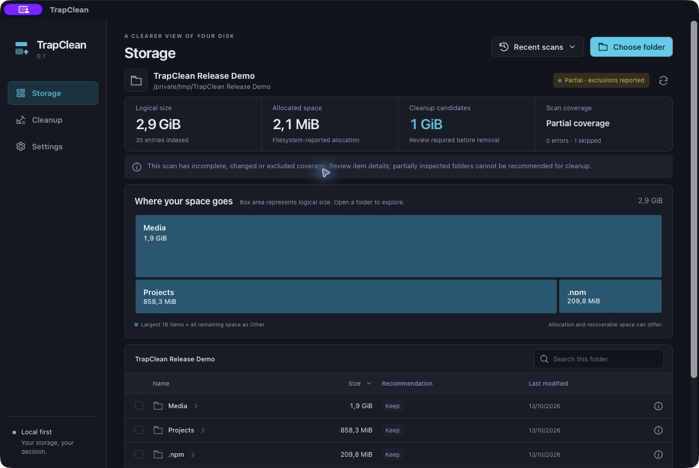
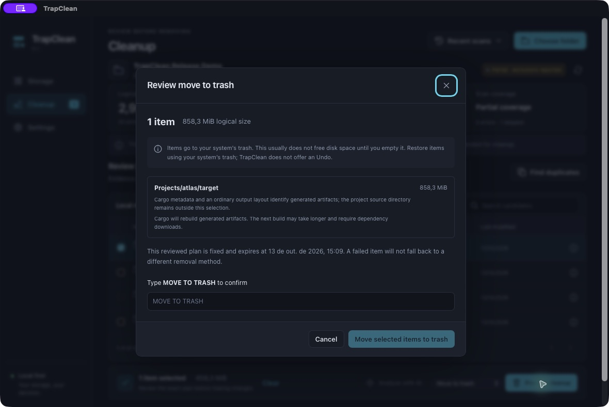
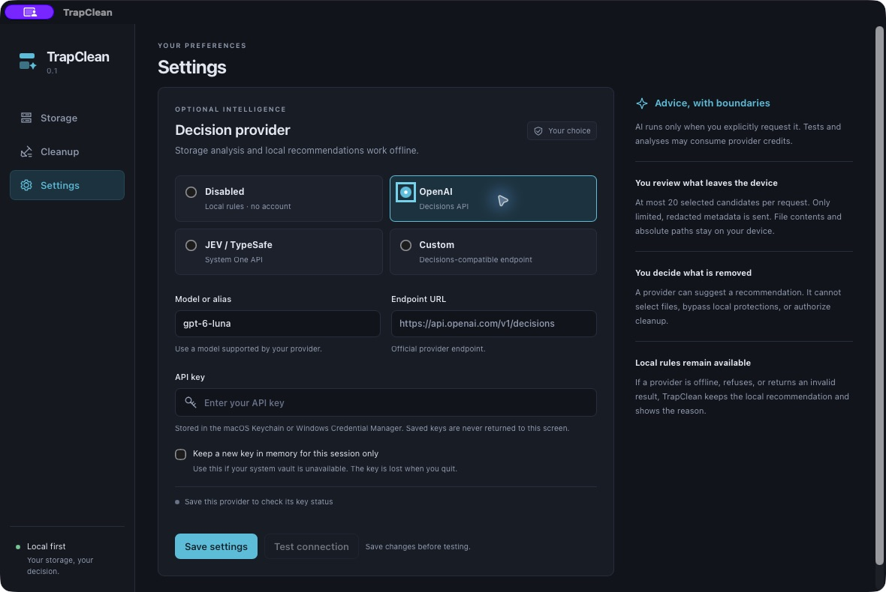

# TrapClean

**Understand what fills your disk, what might be rebuildable, and what a cleanup would change.**

TrapClean is a native desktop app for local storage analysis on Windows and macOS. Scan a folder, explore its largest items, inspect the evidence, then review an exact cleanup plan. It works without an account, API key, remote service, or installed developer tools.



## Download and install

| Your computer                        | Download                                                                                                                                |
| ------------------------------------ | --------------------------------------------------------------------------------------------------------------------------------------- |
| Mac with Apple Silicon (M1 or later) | [TrapClean 0.1.0 · arm64 DMG](https://github.com/TrapstarKS/TrapClean/releases/download/v0.1.0/TrapClean_0.1.0_macos-arm64.dmg)         |
| Mac with an Intel processor          | [TrapClean 0.1.0 · x64 DMG](https://github.com/TrapstarKS/TrapClean/releases/download/v0.1.0/TrapClean_0.1.0_macos-x64.dmg)             |
| Windows 10/11, 64-bit                | [TrapClean 0.1.0 · Windows installer](https://github.com/TrapstarKS/TrapClean/releases/download/v0.1.0/TrapClean_0.1.0_windows-x64.exe) |

[Release notes and SHA-256 checksums](https://github.com/TrapstarKS/TrapClean/releases/tag/v0.1.0) · [Validation evidence](docs/validation.md) · [Installer smoke methodology](docs/installation-smoke-method.md)

The release code passed native installation/startup checks on all three platforms before publication. macOS Apple Silicon also has interactive fixture coverage. Exact delivery-SHA runtime receipts accompany the release; see the validation report for platform results and startup limits.

**macOS 12.3 or later** (12.3 itself has not been runtime-tested): open the DMG, drag TrapClean to Applications, then open it. The builds are ad-hoc signed, **not notarized**. Gatekeeper may require approval in System Settings → Privacy & Security → Open Anyway after the first attempted opening. Only approve a download you trust. This does not disable system protections. See [Apple's instructions for opening an unidentified app](https://support.apple.com/guide/mac-help/open-a-mac-app-from-an-unknown-developer-mh40616/mac).

**Windows:** open the EXE and follow the short installer. It installs for your user. Microsoft Edge WebView2 is used; if missing, the installer downloads and installs Microsoft's runtime automatically (internet is needed for that first setup). The installer is unsigned, so Windows may display a publisher warning. No Rust, Node.js, Python, or command line is needed to run TrapClean.

## Use it

1. **Choose folder** and start a scan. You can select a local drive or an external drive's folder.
2. In **Storage**, open folders in the proportional map or table. Sort, search, page through results, and inspect details. The map includes an **Other** tile for entries outside its largest 18 boxes.
3. In **Cleanup**, review recognized builds/caches and uncertain candidates. Nothing is selected automatically. Duplicate analysis runs only when you request it and verifies full file content.
4. Select items, preview their paths and consequences, and type the requested confirmation. **Move to Trash** is the default. Permanent deletion is a separate action.
5. Read each item's result. TrapClean automatically starts a fresh scan after cleanup.



**Candidate for cleanup** means observed evidence identifies rebuildable storage; it is not a safety guarantee. **Review required** means important facts remain uncertain. **Keep** means the app has no basis to recommend cleanup or the data is protected. Folder names alone do not establish recoverability.

Cargo output is recognized using a manifest, preserved source directory, artifact marker and output layout. Target configuration, mixed contents, protected descendants and incomplete coverage block automatic eligibility. JavaScript dependencies remain review items: a manifest/lockfile does not prove download availability or the absence of local package changes. The npm content-addressed cache has a specific layout rule. TrapClean never runs project scripts, package hooks, `cargo clean`, or provider-generated commands.

## What the numbers mean

- **Logical size** measures file lengths and can include sparse regions and multiple hardlink names. **Allocated size** uses filesystem allocation when available, deduplicating hardlinks. The UI labels allocation estimates.
- APFS clones, compression, snapshots and other shared storage can prevent shown bytes from becoming free space. Reclaimable bytes are an estimate, not a promise.
- **Moving to Trash normally does not free space until those items are removed from Trash.** TrapClean does not empty your entire Trash. Restore moved items using Finder/Recycle Bin; there is no simulated Undo. Captured items may retain a temporary staging location in their system restore metadata. Move them manually to the original location shown in the result. On Windows, restore the TrapClean staging folder from Recycle Bin, then move its contained selected item back to that location.
- Cleanup results separate bytes moved, bytes permanently deleted and the measured change in free disk space. Concurrent activity, open files and snapshots can make these differ.
- **Last modified** is not last used. Access times are reported as supplied by the filesystem and may be disabled, delayed or changed by duplicate reading. Process usage is unknown unless explicitly checked; no claim of inactivity is made.
- Links, junctions, reparse points, mounted filesystems and special objects are not followed automatically. Errors and skipped items produce partial coverage. Uninspected folders cannot become cleanup candidates.

Only three recent scans are retained. Remove one from the recent scan menu to delete its local index. A scan is a snapshot; changed identities or contents are refused at cleanup. Very deep trees, denied access and OS calls blocked by a disconnected drive may slow or interrupt the scan. Duplicate results are bounded to 200 groups and 20 independent members per group; hardlinks are not extra copies, and at least one unchanged independent copy must remain. Files with nonempty macOS resource forks, Windows named data streams or stream metadata that cannot be inspected are excluded from duplicate confirmation. Equal accepted content does not prove equal extended metadata, purpose or future use.

## Optional AI

AI starts **Disabled**. All scanning, local recommendations, duplicate verification, preview and cleanup work offline.

| Mode           | Configuration                              | Contract                                                          |
| -------------- | ------------------------------------------ | ----------------------------------------------------------------- |
| OpenAI         | API key and supported model (`gpt-6-luna`) | Official `POST https://api.openai.com/v1/decisions`               |
| JEV / TypeSafe | API key and supported model/alias          | Official `POST https://api.typesafe.ai/v1/systemone`              |
| Custom         | Full endpoint URL, model and optional key  | The textual OpenAI Decisions contract, **not chat compatibility** |



**Test connection** sends a synthetic decision only when you confirm it. **Analyze with AI** first shows which selected candidate metadata will leave the device. Both may consume provider credits. Provider errors, refusals and insufficient evidence return to local recommendations with an explicit status; they never enable more aggressive cleanup.

API keys are saved in the native macOS Keychain or Windows Credential Manager. If the vault is unavailable, choose explicit session-only storage; keys are never silently saved as plaintext. Remove a key from Settings. Saved keys are never returned to the UI, scan database, export or log.

The app sends at most 20 logical candidate units and a 32 KiB payload: IDs, sanitized root-relative paths, categories, sizes, reported dates, coverage and allowlisted observations. Usernames, arbitrary filenames and freeform disk text are redacted; file contents and complete manifests are never sent. Oversized input is refused rather than silently truncated. The provider sees usage as unknown. Requests time out, can be cancelled, and do not follow redirects. HTTPS is required except for loopback development endpoints. Local result caches expire after seven days, are limited to 500 entries, and include provider/model/policy and candidate facts in their identity.

AI choices are recommendations. The Rust backend calculates sizes, protects data, creates the immutable plan and revalidates the filesystem. A probability and provider confidence have different meanings; neither authorizes removal.

[Provider details and current primary references](docs/providers.md) · [Custom contract and request/response examples](docs/custom-provider.md)

There is no telemetry, background daemon, global watcher, local AI model, weights download, VPS setup, or remote/SSH scan in v0.1.0. The SQLite index and nonsecret preferences remain local. Network access occurs only for explicitly requested provider calls and installer WebView2 setup.

## Quickstart em português

Baixe o `.dmg` da arquitetura do seu Mac ou o `.exe` para Windows. No Mac, abra o DMG e arraste para Aplicativos; no Windows, abra o instalador. Não precisa instalar ferramentas de programação. Escolha uma pasta, veja os maiores itens e confira as evidências em **Cleanup**. Revise a prévia e confirme a ação. A lixeira normalmente só libera espaço quando os itens são apagados dela. IA é opcional e começa desativada.

## Build and development

Development requires Rust stable 1.90+, Node.js 24+, and [Tauri's platform prerequisites](https://v2.tauri.app/start/prerequisites/). Users installing a release do not need these.

```sh
npm ci
npm run tauri -- dev
```

```sh
npm run check
npm run format:check
npm run build
cargo fmt --manifest-path src-tauri/Cargo.toml --check
cargo clippy --manifest-path src-tauri/Cargo.toml --locked --all-targets -- -D warnings
cargo test --manifest-path src-tauri/Cargo.toml --locked
npx playwright install chromium
npm run test:ui
```

Build an installer on its native platform:

```sh
# Apple Silicon; use x86_64-apple-darwin for Intel
npm run tauri -- build --target aarch64-apple-darwin --bundles dmg
# Windows x64
npm run tauri -- build --target x86_64-pc-windows-msvc --bundles nsis
```

The Svelte 5/TypeScript/Vite frontend is embedded as static assets in Tauri 2. Rust handles the scanner, SQLite index, deterministic rules, streaming hashes, providers and cleanup. Memory is bounded by small database pages, disk-backed directory queues and streaming buffers. Frontend queries are typed commands; it cannot send arbitrary SQL or paths for deletion. The icon source is [SVG](src-tauri/icons/source.svg); regenerate desktop formats with `npm run tauri -- icon src-tauri/icons/source.svg`.

GitHub Actions is configured to check macOS/Windows and build DMGs for arm64/x64 and an NSIS EXE for Windows x64. Installer artifacts include their source SHA and SHA-256 checksums. Tagged builds create a draft release for artifact verification before publication. Build success, installation/runtime testing and measured performance are reported separately in [validation](docs/validation.md). Rust-only warm-metadata benchmarks do not represent total app/WebView memory or user-visible latency. The [cleanup boundaries](docs/security.md) explain the filesystem protections and remaining limits.

## Support and license

[Report a bug or ask a question](https://github.com/TrapstarKS/TrapClean/issues). Avoid attaching private file paths, credentials or sensitive scan data to public issues. Licensed under [MIT](LICENSE).
